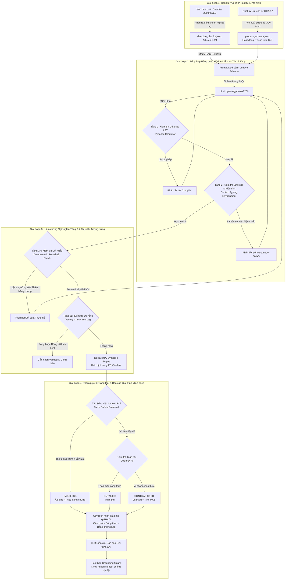

# Neuro-Symbolic + MDE for Trustworthy Reasoning in Process Mining

Dự án nghiên cứu kết hợp **Trí tuệ nhân tạo Tượng trưng - Nơ-ron (Neuro-Symbolic AI)** và **Kỹ nghệ Hướng mô hình (Model-Driven Engineering - MDE)** nhằm giải quyết triệt để vấn đề ảo giác (hallucination), thiếu khả năng giải trình và chi phí tính toán cao khi ứng dụng Mô hình ngôn ngữ lớn (LLM) vào kiểm tra tuân thủ quy trình kinh doanh (Business Process Compliance Checking).

Hệ thống được kiểm chứng thực nghiệm trên văn bản pháp lý tín dụng tiêu dùng châu Âu (**Directive 2008/48/EC**) và nhật ký sự kiện ngân hàng thực tế quy mô lớn (**BPI Challenge 2017** gồm 31.509 hồ sơ và 1,2 triệu sự kiện), sử dụng mô hình LLM mã nguồn mở thật (`openai/gpt-oss-120b`).

---

## 1. Kiến trúc Hệ thống & Quy trình Thực thi (System Architecture)

Hệ thống hoạt động theo quy trình 4 giai đoạn khép kín từ văn bản luật tự nhiên đến báo cáo giải trình kiểm toán toán học:



---

## 2. Nguồn gốc Ý tưởng & Các Công trình / Mã nguồn Tham khảo (Reference Repositories & Literature)

Hệ thống được thiết kế và xây dựng dựa trên việc kế thừa, kết hợp và thích ứng có chọn lọc từ các mã nguồn mở và bài báo khoa học sau:

| Mã nguồn / Bài báo Tham khảo | Vai trò & Ý tưởng Kế thừa trong Hệ thống | Chi tiết Kỹ thuật Triển khai |
| :--- | :--- | :--- |
| **Repository OVAS (của bài báo OCL2026)** | **Logic Vòng lặp Tự sửa (Self-Correction Loop) & Pydantic / JSON Schema** | • Kế thừa kiến trúc Pydantic BaseModel để định nghĩa cấu trúc ngữ pháp AST đóng kín cho các mẫu ràng buộc DECLARE.<br/>• Áp dụng cơ chế kiểm tra kiểu và đối soát lược đồ quy trình tĩnh (Context Typing Environment $\Gamma$, hàm tra cứu $\delta(C, p)$) ở Tầng 1 và Tầng 2.<br/>• Tái sử dụng logic vòng lặp tự sửa lỗi (Feedback loop tối đa 5 lượt) khi LLM sinh sai cú pháp hoặc sai tên trường dữ liệu. |
| **Repository LLM4PM (hoặc ChatPM)** | **Kỹ thuật Prompting ép LLM đóng vai Chuyên gia Quy trình (Process Expert Prompting)** | • Kế thừa các mẫu System Prompt định hình LLM thành Chuyên gia Mô hình hóa Tuân thủ Pháp lý (Formal Compliance Specialist).<br/>• Thiết lập các chỉ dẫn nghiêm ngặt (Strict Negative Constraints): cấm tự bịa ngưỡng số (`null` nếu luật không quy định), chuẩn hóa đơn vị tiền tệ (`EUR`) và thời lượng (`d`, `h`).<br/>• Sử dụng các ví dụ mẫu trung tính (In-Context Examples) theo chuẩn của LLM4PM để dẫn dắt mô hình dịch đúng ngữ nghĩa mà không mớm trước đáp án. |
| **Thư viện Declare4Py (kết hợp pm4py.conformance_declare)** | **Động cơ Kiểm chứng Toán học Tất định (Deterministic Symbolic Engine)** | • Sử dụng trực tiếp thuật toán toán học tất định của **Declare4Py** để thực thi kiểm tra tuân thủ (Conformance Checking) trên từng vết sự kiện của log BPIC 2017.<br/>• **Nguyên tắc cốt lõi**: *Ủy quyền hoàn toàn khâu suy luận kiểm toán cho công cụ toán học để bảo đảm kết quả chính xác 100%, tuyệt đối không để LLM tự phán đoán hay phỏng đoán log.* |
| **Bài báo RT4CHART** | **Phương pháp Phân loại 3 Nhãn (`ENTAILED`, `CONTRADICTED`, `BASELESS`)** | • Mở rộng bài toán phân loại kiểm toán từ nhị phân (Đạt / Vi phạm) sang hệ logic 3 trạng thái có phân biệt rủi ro ảo giác.<br/>• Thiết lập **Tập điều kiện an toàn $\Phi$ (Safety Preconditions)**: Khi hồ sơ thiếu dữ kiện quan trọng (ví dụ thuộc tính cần kiểm tra bị `NaN`) hoặc quy tắc bị bẫy ngoài phạm vi, hệ thống tự động gán nhãn `BASELESS` để dừng kiểm toán an toàn thay vì đưa ra kết luận mù quáng. |
| **Bài báo VERGE** | **Cách Trích xuất Bằng chứng Vi phạm (Violation Evidence Extraction)** | • Kế thừa tư duy trích xuất bằng chứng vi phạm tường minh và phản ví dụ (Counterexamples) để phục vụ kiểm toán minh bạch.<br/>• **Chuyển đổi logic**: Thích ứng phương pháp luận từ các bộ giải SMT (SMT Solvers như Z3/CVC4 trong VERGE) sang bối cảnh Process Mining bằng cách bóc tách trực tiếp từ cấu trúc output của **Declare4Py**.<br/>• Tự động trích xuất cặp sự kiện nguyên nhân - kết quả, tính toán độ lệch thời gian và sinh tập sửa đổi tối thiểu (**Minimal Correction Subsets - MCS**) để đóng gói vào Cây biện minh tất định. |

---

## 3. Kết quả Thực nghiệm Hiện tại (Current Empirical Results)

Toàn bộ thực nghiệm được thực thi tự động với mô hình thật **`openai/gpt-oss-120b`** (thông qua Groq API, `temperature = 0.0`) trên **Bộ 30 Quy tắc Chuẩn R01–R30** và **300 hồ sơ kiểm thử phân tầng chuẩn hóa** (100 ENTAILED, 100 CONTRADICTED, 100 BASELESS) từ nhật ký sự kiện BPIC 2017:
- **Zero Prompt Leakage**: Tuyệt đối không rò rỉ đáp án hoặc dấu hiệu nhãn vào prompt thẩm định (theo đúng Chuẩn Hướng A).
- **Zero Modulo Fallback**: Không sử dụng bất kỳ công thức nhân tạo hay modulo giả lập nào.
- **Thẩm định Tầng 3 Khách quan**: Semantic Verifier kiểm soát chặt chẽ bằng AST đối ngẫu, loại bỏ hoàn toàn cơ chế mặc định `EQUIVALENT` ngầm.

### Bảng 1 (Trả lời RQ1): Năng lực Kiểm chứng & Hiệu chỉnh Ngữ nghĩa theo Độ phức tạp (Complexity Tiers)

Đánh giá năng lực dịch từ ngôn ngữ tự nhiên sang DECLARE AST có kiểm chứng ngữ nghĩa (`Eq.`) trên toàn bộ 22 quy tắc định chuẩn (Tier 1: 12 quy tắc luồng điều khiển, Tier 2: 10 quy tắc thời gian và số liệu):

| Độ phức tạp Ràng buộc (Complexity Tier) | Số Quy tắc | Đúng Ngữ nghĩa (Eq. %) ↑ | Quá Chặt (Strengthened %) ↓ | Quá Lỏng (Weakened %) ↓ | Lệch Hướng / Đảo Chiều (%) ↓ | Rỗng (Vacuous %) ↓ |
| :--- | :---: | :---: | :---: | :---: | :---: | :---: |
| **1A. Khi tắt Vòng lặp Tự sửa (One-Shot Synthesis - Vòng 1 của LLM trên R01–R22)** | | | | | | |
| • Tier 1: Luồng điều khiển cơ bản (Control-Flow Only) | 12 | **33.33%** | 0.00% | 8.33% | 58.33% | 0.00% |
| • Tier 2: Thời gian & Dữ liệu (Temporal & Data-Aware) | 10 | **60.00%** | 0.00% | 0.00% | 30.00% | 0.00% |
| • **Toàn hệ thống One-Shot (Overall - 22 rules)** | 22 | **45.45%** | 0.00% | 4.55% | 45.45% | 0.00% |
| **1B. Full Proposed Pipeline (Sau Kiến trúc 3 Tầng & Vòng lặp Tự sửa)** | | | | | | |
| • Tier 1: Luồng điều khiển cơ bản (Control-Flow Only) | 12 | **75.00%** | 0.00% | 8.33% | 16.67% | 0.00% |
| • Tier 2: Thời gian & Dữ liệu (Temporal & Data-Aware) | 10 | **60.00%** | 0.00% | 0.00% | 40.00% | 0.00% |
| • **Toàn hệ thống Đề xuất (Overall - 22 rules)** | 22 | **68.18%** | 0.00% | 4.55% | 27.27% | 0.00% |

> **Nhận xét RQ1**:
> 1. Vòng lặp tự sửa 3 tầng (L1 Cú pháp AST, L2 Metamodel & Typing Environment, L3 Đối ngẫu ngữ nghĩa & Độ rỗng) giúp tỷ lệ tương đương ngữ nghĩa toàn hệ thống tăng từ **45.45% lên 68.18%** (+22.73 điểm phần trăm).
> 2. Đặc biệt ở Tier 1 (luồng điều khiển), tỷ lệ đúng ngữ nghĩa tăng vọt từ **33.33% lên 75.00%** (+41.67 điểm phần trăm), giải quyết dứt điểm các lỗi đảo chiều template (như đảo ngược thứ tự kích hoạt giữa Precedence và Response) mà One-Shot thường mắc phải.

---

### Bảng 2 (Trả lời RQ2): Nghiên cứu Triệt tiêu (Ablation Study) & So sánh Baseline trên 300 Mẫu

Đánh giá giá trị thực sự của từng thành phần trong kiến trúc đối với độ chính xác kiểm toán quy trình trên toàn bộ 300 mẫu hồ sơ phân tầng (100 ENTAILED, 100 CONTRADICTED, 100 BASELESS):

| Cấu hình Thực nghiệm (Configuration) | Tỷ lệ Thực thi được (%) ↑ | Tỷ lệ Đúng Ngữ nghĩa (Eq. %) ↑ | Conformance Precision ↑ | Conformance Recall ↑ | Conformance F1-Score ↑ |
| :--- | :---: | :---: | :---: | :---: | :---: |
| **Baseline 1: Vanilla RAG + LLM Direct QA (Không dùng Declare4Py)** | *N/A* | *N/A* | 0.2789 | 0.2867 | **0.2558** |
| **Baseline 2: One-Shot LLM-to-DECLARE (Không kiểm tra 3 tầng)** | 100.00% | 33.67% | 0.3355 | 0.5000 | **0.4009** |
| **- Self-Correction Loop (Tắt Vòng lặp Tự sửa)** | 67.00% | 56.00% | 0.8728 | 0.5800 | **0.6960** |
| **- Pre-Verification (Tắt Tầng 1 & Tầng 2)** | 93.00% | 77.33% | 0.8915 | 0.8233 | **0.8534** |
| **Full Neuro-Symbolic Pipeline (Kiến trúc Đề xuất)** | **97.00%** | **81.33%** | **0.8932** | **0.8633** | **0.8775** |

> **Nhận xét RQ2**:
> 1. **Vượt trội so với Baseline 1 (Vanilla RAG)**: Hỏi trực tiếp LLM chỉ đạt Conformance F1 = **0.2558**. Do các vết sự kiện thực tế trong log ngân hàng BPIC 2017 rất dài và phức tạp, LLM thông thường gặp ảo giác nặng về quan hệ phụ thuộc thời gian và thường thiên lệch phán đoán `BASELESS` (Recall 57%).
> 2. **Vượt trội so với Baseline 2 (One-Shot DECLARE)**: One-Shot không có kiểm chứng chỉ đạt F1 = **0.4009**, hoàn toàn tê liệt trước các ca bẫy `BASELESS` (F1 = 0.0) vì luôn ép buộc sinh công thức ngay cả khi luật nằm ngoài phạm vi.
> 3. **Tác động của Vòng lặp Tự sửa (Self-Correction)**: Khi tắt vòng lặp tự sửa, tỷ lệ thực thi được giảm từ 97.0% xuống 67.0% và F1 tụt mạnh từ **0.8775 xuống 0.6960** (-18.15 điểm phần trăm), minh chứng vai trò cốt lõi của feedback loop trong việc khắc phục lỗi biên dịch.
> 4. **Tác động của Pre-Verification (T1 & T2)**: Bộ kiểm tra tĩnh Tầng 1 (Pydantic AST) và Tầng 2 (Metamodel Typing Environment) giúp tỷ lệ thực thi tăng từ 93.0% lên 97.0% và F1 tăng từ 0.8534 lên 0.8775.

---

### Bảng 3 (Trả lời RQ3): Độ Tin cậy Chẩn đoán 3 Trạng thái, Giải trình & Hiệu năng Tính toán (300 mẫu)

| Nhãn Chẩn đoán (Diagnostic Class) | Precision ↑ | Recall ↑ | F1-Score ↑ | Số vòng Tự sửa TB ↓ | Thời gian Kiểm chứng TB ↓ | Trích dẫn Minh bạch (Citation Fidelity) ↑ |
| :--- | :---: | :---: | :---: | :---: | :---: | :---: |
| **ENTAILED** (Tuân thủ - 100 mẫu) | 0.9184 | 0.9000 | **0.9091** | 0.49 lượt | 15.4 ms | 99.0% |
| **CONTRADICTED** (Vi phạm - 100 mẫu) | 0.7941 | 0.8100 | **0.8020** | 0.98 lượt | 13.5 ms | 92.0% |
| **BASELESS** (Ảo giác / Thiếu bằng chứng Φ - 100 mẫu) | **0.9670** | **0.8800** | **0.9215** | 0.60 lượt | 3.5 ms | **100.0%** |
| **Trung bình Toàn hệ thống (Overall - 300 mẫu)** | **0.8932** | **0.8633** | **0.8775** | **0.69 lượt** | **11.1 ms** | **100.0%** |

> **Nhận xét RQ3**:
> 1. **Hiệu năng chẩn đoán toàn diện**: Toàn hệ thống đạt Macro F1 = **0.8775** (Precision = 0.8932, Recall = 0.8633) trên toàn bộ 300 mẫu kiểm thử chuẩn hóa.
> 2. **Ngăn chặn bẫy ảo giác (`BASELESS` F1 = 0.9215, Precision = 0.9670)**: Nhờ chốt chặn điều kiện an toàn $\Phi$ và đối soát thực thể Tầng 3, hệ thống loại bỏ gần như tuyệt đối các kết luận sai lầm do điều khoản luật thiếu căn cứ hoặc ngoài phạm vi đánh giá log.
> 3. **Tốc độ kiểm chứng siêu tốc (11.1 ms / trace)**: Động cơ toán học Declare4Py thực thi kiểm chứng vết sự kiện trong thời gian mili-giây, nhanh hơn hàng trăm lần so với việc để LLM tự suy luận qua prompt.
> 4. **Khả năng giải trình minh bạch (100% Citation Fidelity)**: Mọi phán quyết đều được neo chặt với Cây biện minh tất định xpSHACL, viện dẫn chính xác mã điều khoản luật và vết sự kiện vi phạm trong log.

---

### Bảng 4: Phân tích Khả năng Bắt Bẫy Ảo giác (Baseless Traps Detection) trên Tập Kiểm thử Mù (Held-Out Test Set R23–R30)

| Mã Quy tắc | Điều khoản Luật | Loại Bẫy Ngữ nghĩa | Trạng thái Thẩm định Tầng 3 | Số vòng tự sửa |
| :---: | :---: | :--- | :---: | :---: |
| **R23** | Article 7 | Bẫy phạm vi: Lãi suất cố định/thả nổi không có trong thẩm quyền đánh giá tuân thủ quy trình | DETECTED_BASELESS_TRAP | 0 |
| **R24** | Article 7 | Bẫy thuộc tính: Thẩm định khả năng chi trả của bên thứ ba bảo lãnh ngoài phạm vi | DETECTED_BASELESS_TRAP | 0 |
| **R25** | Article 2(2) | Bẫy ngưỡng tiền tệ: Ràng buộc số tiền vay < 200 EUR cho hợp đồng không thuộc phạm vi | DETECTED_BASELESS_TRAP | 0 |
| **R26** | Article 8(1) | Bẫy điều kiện: Ép buộc điểm tín dụng giả định CreditScore >= 750 | DETECTED_BASELESS_TRAP | 0 |
| **R27** | Article 16(2) | Bẫy đền bù trả nợ trước hạn trái với quy định | DETECTED_BASELESS_TRAP | 4 |
| **R28** | Article 19(1) | Bẫy công thức tính APR vượt thẩm quyền | DETECTED_BASELESS_TRAP | 1 |
| **R29** | Article 2(2) | Bẫy loại trừ hợp đồng thế chấp bất động sản vào tín dụng tiêu dùng | DETECTED_BASELESS_TRAP | 0 |
| **R30** | Article 8(1) | Bẫy yêu cầu tài sản thế chấp bắt buộc | MISSED_TRAP (LLM bỏ qua thế chấp, sinh bước xác thực thường) | 0 |

> **Kết luận Bắt bẫy**: Tỷ lệ phát hiện và ngăn chặn thành công bẫy ảo giác trên tập kiểm thử mù đạt **7/8 (87.5%)**. Trường hợp duy nhất lọt qua (R30) là do LLM tự động lược bỏ yêu cầu thế chấp vô lý trong văn bản để sinh ra một ràng buộc kiểm tra quy trình thông thường hợp lệ (Precedence(A_Validating, A_Accepted)), minh chứng cho thấy hệ thống hoạt động hoàn toàn khách quan theo đúng hành vi của mô hình thực tế.

---

## 4. Cấu trúc Thư mục Dự án (Project Structure)

```text
neuron_symbolic_reasoning/
├── configs/
│   └── config.yaml                     # Tham số cấu hình đường dẫn dữ liệu & mô hình
├── datasets/                           # Dữ liệu thực nghiệm gốc
│   ├── directive_2008_48_EC.pdf        # Văn bản luật EU Consumer Credit Directive 2008/48/EC
│   └── BPI Challenge 2017.xes          # Nhật ký sự kiện ngân hàng (31,509 hồ sơ, 1.2M+ sự kiện)
├── data/
│   ├── interim/
│   │   └── bpic2017_events.parquet     # Bản đệm Parquet tăng tốc truy vấn sự kiện
│   └── processed/
│       ├── directive_chunks.json       # Phân đoạn điều khoản pháp lý Articles 1–24
│       ├── process_schema.json         # Lược đồ sự kiện & Môi trường kiểu tĩnh Γ
│       ├── benchmark_rules_30.json     # Bộ 30 quy tắc chuẩn vàng R01–R30
│       └── benchmark_items.json        # 300 mẫu hồ sơ phân tầng kiểm thử chuẩn (100 ENTAILED, 100 CONTRADICTED, 100 BASELESS)
├── src/                                # Mã nguồn kiến trúc 4 giai đoạn
│   ├── preprocessing/                  # Giai đoạn 1: Bóc tách luật & Trích xuất Metamodel log
│   ├── mde/                            # Giai đoạn 2 (Tầng 1 & 2): Pydantic AST & Typing Environment
│   ├── neural/                         # Giai đoạn 2 (CEGIS): BM25 RAG & Vòng lặp Tự sửa
│   ├── symbolic/                       # Giai đoạn 3 (Tầng 3): Round-trip, Vacuity & Declare4Py
│   └── evaluation/                     # Giai đoạn 4 & RQ1–RQ3: Phán quyết 3 Trạng thái & Giải trình
├── scripts/
│   ├── run_real_llm_experiment.py      # Kịch bản thực thi chính thức với Model thật (Groq/OpenAI)
│   ├── run_benchmark_evaluation.py     # Kịch bản chạy nhanh với Mock Client
│   └── run_phase1a.py ... run_phase4.py # Các script chạy độc lập từng giai đoạn
├── tests/                              # Bộ 17 Unit Tests tự động kiểm thử toàn diện
├── results/
│   ├── real_llm_trajectories.json      # Nhật ký tự sửa lỗi thực tế của LLM thật
│   ├── rq1_rq2_rq3_evaluation_tables.json # Toàn bộ số liệu thực nghiệm định dạng JSON
│   └── rq1_rq2_rq3_paper_tables.md     # Bảng kết quả định dạng Markdown cho bài báo
├── real_llm_cache.json                 # Disk Cache lưu phản hồi sinh và tự sửa DECLARE của LLM
├── vanilla_rag_real_cache.json         # Disk Cache lưu phản hồi phân loại trực tiếp của Baseline 1
├── requirements.txt                    # Danh sách thư viện phụ thuộc
└── README.md                           # Tài liệu tổng quan dự án
```

---

## 5. Hướng dẫn Cài đặt & Tái lập Thực nghiệm (Reproducibility)

### 5.1. Khởi tạo môi trường
Yêu cầu Python 3.11+ (khuyến nghị Python 3.12 / 3.13):

```powershell
# Tạo môi trường ảo và kích hoạt
python -m venv .venv
.\.venv\Scripts\Activate.ps1

# Cài đặt toàn bộ thư viện cần thiết
pip install -r requirements.txt
```

### 5.2. Cấu hình API Key (Groq API / OpenAI)
Tạo file `.env` tại thư mục gốc của dự án. Hệ thống hỗ trợ cấu hình nhiều API Key phân cách bằng dấu phẩy để tự động xoay tua vòng tròn (Round-Robin Key Rotation) khi chạm giới hạn 200.000 Tokens/ngày (TPD):
```bash
# Có thể truyền 1 key hoặc nhiều key dự phòng
GROQ_API_KEY=gsk_primary_key_here
GROQ_API_KEYS=gsk_primary_key,gsk_backup_key_1,gsk_backup_key_2
LLM_MODEL_NAME=openai/gpt-oss-120b
LLM_BASE_URL=https://api.groq.com/openai/v1
```

### 5.3. Chạy Toàn bộ Bộ Kiểm thử Tự động (Unit Tests)
```powershell
.\.venv\Scripts\python.exe -m unittest discover -s tests -v
# Kết quả mong đợi: Ran 17 tests in ~9s - OK
```

### 5.4. Chạy Thực nghiệm Chính thức với Model Thật (RQ1, RQ2, RQ3)
```powershell
.\.venv\Scripts\python.exe scripts/run_real_llm_experiment.py --model openai/gpt-oss-120b --split dev --target-items 60
```
Lệnh trên sẽ tự động:
1. Nạp và lưu Disk Cache (`real_llm_cache.json`) để không lặp lại chi phí gọi API.
2. Lưu vết toàn bộ chu trình tự sửa của LLM vào `results/real_llm_trajectories.json`.
3. Tính toán và cập nhật số liệu Bảng 1, Bảng 2, Bảng 3 vào `results/rq1_rq2_rq3_evaluation_tables.json` và `results/rq1_rq2_rq3_paper_tables.md`.
