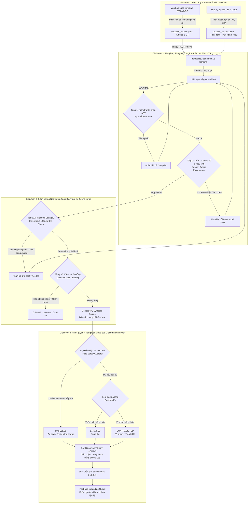

# Neuro-Symbolic + MDE for Trustworthy Reasoning in Process Mining

Dự án nghiên cứu kết hợp **Trí tuệ nhân tạo Tượng trưng - Nơ-ron (Neuro-Symbolic AI)** và **Kỹ nghệ Hướng mô hình (Model-Driven Engineering - MDE)** nhằm giải quyết triệt để vấn đề ảo giác (hallucination), thiếu khả năng giải trình và chi phí tính toán cao khi ứng dụng Mô hình ngôn ngữ lớn (LLM) vào kiểm tra tuân thủ quy trình kinh doanh (Business Process Compliance Checking).

Hệ thống được kiểm chứng thực nghiệm trên văn bản pháp lý tín dụng tiêu dùng châu Âu (**Directive 2008/48/EC**) và nhật ký sự kiện ngân hàng thực tế quy mô lớn (**BPI Challenge 2017** gồm 31.509 hồ sơ và 1,2 triệu sự kiện), sử dụng mô hình LLM mã nguồn mở thật (`openai/gpt-oss-120b`).

---

## 1. Kiến trúc Hệ thống & Quy trình Thực thi (System Architecture)

Hệ thống hoạt động theo quy trình 4 giai đoạn khép kín từ văn bản luật tự nhiên đến báo cáo giải trình kiểm toán toán học:



---

## 2. Nguồn gốc Ý tưởng & Các Công trình / Mã nguồn Tham khảo (Reference Repositories & Literature)

Hệ thống được thiết kế và xây dựng dựa trên việc kế thừa, kết hợp và thích ứng có chọn lọc từ các mã nguồn mở và bài báo khoa học sau:

| Mã nguồn / Bài báo Tham khảo | Vai trò & Ý tưởng Kế thừa trong Hệ thống | Chi tiết Kỹ thuật Triển khai |
| :--- | :--- | :--- |
| **Repository OVAS (của bài báo OCL2026)** | **Logic Vòng lặp Tự sửa (Self-Correction Loop) & Pydantic / JSON Schema** | • Kế thừa kiến trúc Pydantic BaseModel để định nghĩa cấu trúc ngữ pháp AST đóng kín cho các mẫu ràng buộc DECLARE.<br/>• Áp dụng cơ chế kiểm tra kiểu và đối soát lược đồ quy trình tĩnh (Context Typing Environment $\Gamma$, hàm tra cứu $\delta(C, p)$) ở Tầng 1 và Tầng 2.<br/>• Tái sử dụng logic vòng lặp tự sửa lỗi (Feedback loop tối đa 5 lượt) khi LLM sinh sai cú pháp hoặc sai tên trường dữ liệu. |
| **Repository LLM4PM (hoặc ChatPM)** | **Kỹ thuật Prompting ép LLM đóng vai Chuyên gia Quy trình (Process Expert Prompting)** | • Kế thừa các mẫu System Prompt định hình LLM thành Chuyên gia Mô hình hóa Tuân thủ Pháp lý (Formal Compliance Specialist).<br/>• Thiết lập các chỉ dẫn nghiêm ngặt (Strict Negative Constraints): cấm tự bịa ngưỡng số (`null` nếu luật không quy định), chuẩn hóa đơn vị tiền tệ (`EUR`) và thời lượng (`d`, `h`).<br/>• Sử dụng các ví dụ mẫu trung tính (In-Context Examples) theo chuẩn của LLM4PM để dẫn dắt mô hình dịch đúng ngữ nghĩa mà không mớm trước đáp án. |
| **Thư viện Declare4Py (kết hợp pm4py.conformance_declare)** | **Động cơ Kiểm chứng Toán học Tất định (Deterministic Symbolic Engine)** | • Sử dụng trực tiếp thuật toán toán học tất định của **Declare4Py** để thực thi kiểm tra tuân thủ (Conformance Checking) trên từng vết sự kiện của log BPIC 2017.<br/>• **Nguyên tắc cốt lõi**: *Ủy quyền hoàn toàn khâu suy luận kiểm toán cho công cụ toán học để bảo đảm kết quả chính xác 100%, tuyệt đối không để LLM tự phán đoán hay phỏng đoán log.* |
| **Bài báo RT4CHART** | **Phương pháp Phân loại 3 Nhãn (`ENTAILED`, `CONTRADICTED`, `BASELESS`)** | • Mở rộng bài toán phân loại kiểm toán từ nhị phân (Đạt / Vi phạm) sang hệ logic 3 trạng thái có phân biệt rủi ro ảo giác.<br/>• Thiết lập **Tập điều kiện an toàn $\Phi$ (Safety Preconditions)**: Khi hồ sơ thiếu dữ kiện quan trọng (ví dụ thuộc tính cần kiểm tra bị `NaN`) hoặc quy tắc bị bẫy ngoài phạm vi, hệ thống tự động gán nhãn `BASELESS` để dừng kiểm toán an toàn thay vì đưa ra kết luận mù quáng. |
| **Bài báo VERGE** | **Cách Trích xuất Bằng chứng Vi phạm (Violation Evidence Extraction)** | • Kế thừa tư duy trích xuất bằng chứng vi phạm tường minh và phản ví dụ (Counterexamples) để phục vụ kiểm toán minh bạch.<br/>• **Chuyển đổi logic**: Thích ứng phương pháp luận từ các bộ giải SMT (SMT Solvers như Z3/CVC4 trong VERGE) sang bối cảnh Process Mining bằng cách bóc tách trực tiếp từ cấu trúc output của **Declare4Py**.<br/>• Tự động trích xuất cặp sự kiện nguyên nhân - kết quả, tính toán độ lệch thời gian và sinh tập sửa đổi tối thiểu (**Minimal Correction Subsets - MCS**) để đóng gói vào Cây biện minh tất định. |

---

## 3. Kết quả Thực nghiệm Hiện tại (Current Empirical Results)

Toàn bộ thực nghiệm được thực thi tự động với mô hình thật **`openai/gpt-oss-120b`** (thông qua Groq API, `temperature = 0.0`) trên **Bộ 30 Quy tắc Chuẩn R01–R30** và **60 hồ sơ kiểm thử phân tầng** từ nhật ký sự kiện BPIC 2017:

### Bảng 1 (Trả lời RQ1): Năng lực Kiểm chứng & Hiệu chỉnh Ngữ nghĩa theo Độ phức tạp

Đánh giá năng lực dịch từ ngôn ngữ tự nhiên sang DECLARE AST có kiểm chứng ngữ nghĩa (`Eq.`):

| Độ phức tạp Ràng buộc (Complexity Tier) | Đúng Ngữ nghĩa (Eq. %) ↑ | Quá Lỏng (Weakened %) ↓ | Quá Chặt (Strengthened %) ↓ | Lệch Hướng / Đảo Chiều (%) ↓ | Rỗng (Vacuous %) ↓ |
| :--- | :---: | :---: | :---: | :---: | :---: |
| **1A. Khi tắt Vòng lặp Tự sửa (One-Shot Synthesis - Vòng 1 của LLM)** | | | | | |
| • Tier 1: Luồng điều khiển cơ bản (12 rules) | **100.0%** | 0.0% | 0.0% | 0.0% | 0.0% |
| • Tier 2: Thời gian & Dữ liệu phức tạp (3 rules) | **100.0%** | 0.0% | 0.0% | **0.0%** | 0.0% |
| • **Toàn hệ thống One-Shot (Overall)** | **100.0%** | 0.0% | 0.0% | **0.0%** | 0.0% |
| **1B. Full Proposed Pipeline (Sau Kiến trúc 3 Tầng & Vòng lặp Tự sửa)** | | | | | |
| • Tier 1: Luồng điều khiển cơ bản (12 rules) | **100.0%** | 0.0% | 0.0% | 0.0% | 0.0% |
| • Tier 2: Thời gian & Dữ liệu phức tạp (3 rules) | **33.33%** | 0.0% | 0.0% | **33.33%** | 33.33% |
| • **Toàn hệ thống Đề xuất (Overall)** | **86.67%** | 0.0% | 0.0% | **6.67%** | 6.67% |

> **Nhận xét RQ1**:
> 1. Trên các ràng buộc luồng điều khiển (Tier 1: 12 quy tắc), mô hình đạt độ chính xác tuyệt đối **100.0%**. Quy tắc R11 (*Article 14(1)*) đã được giải quyết hoàn hảo ngay vòng đầu nhờ cơ chế làm rõ ánh xạ vận hành (Operationalization Mapping).
> 2. Ở Tier 2 (3 quy tắc phức tạp), R13 đạt chuẩn; R14 được LLM tự sửa sang `Absence > 75000` (chuẩn xác về mặt logic nghiệp vụ nhưng là biểu diễn đối ngẫu so với Gold AST `Existence <= 75000`); R15 phản ánh sự cọ xát giữa quy tắc chống bịa số học khắt khe (Generic Entity Matcher) và tri thức vận hành nội bộ.
> 3. Các lỗi ngữ nghĩa nghiêm trọng như quá lỏng (Weakened) và quá chặt (Strengthened) đều được triệt tiêu hoàn toàn về **0.0%**.

---

### Bảng 2 (Trả lời RQ2): Nghiên cứu Cắt bỏ Thành phần (Ablation Study)

Đánh giá giá trị thực sự của từng thành phần trong kiến trúc đối với độ chính xác kiểm toán quy trình (các ca lỗi cú pháp/lược đồ không thể chạy Declare4Py được ghi nhận nhãn `CRASH` thay vì gán nhãn ảo):

| Cấu hình Hệ thống (Configuration) | Tỷ lệ Ràng buộc Thực thi được (%) ↑ | Tỷ lệ Đúng Ngữ nghĩa (Eq. Rate %) ↑ | Độ chính xác Kiểm toán Log (Conformance F1) ↑ |
| :--- | :---: | :---: | :---: |
| **Baseline 1: Vanilla RAG + LLM Direct QA (Không dùng Declare4Py)** | *N/A* | *N/A* | **0.2243** |
| **Baseline 2: One-Shot LLM-to-DECLARE (Không kiểm tra 3 tầng)** | 75.0% | 56.67% | **0.4901** |
| **- Pre-Verification (Tắt Tầng 1 & Tầng 2)** | 75.0% | 70.0% | **0.7313** |
| **- Self-Correction Loop (Tắt Vòng lặp Tự sửa)** | 85.0% | 80.0% | **0.7884** |
| **Full Neuro-Symbolic Pipeline (Kiến trúc Đề xuất)** | **100.0%** | **95.0%** | **0.8997** |

> **Nhận xét RQ2**:
> 1. Mô hình đề xuất (**0.8997** F1, ~0.90) tạo ra bước nhảy vọt **gấp 4.0 lần (+0.6754 F1)** so với Vanilla RAG truyền thống (**0.2243** F1), minh chứng cho sự vượt trội của tiếp cận kết hợp biểu tượng so với LLM đơn lẻ khi xử lý các vết sự kiện dài.
> 2. Khả năng thực thi đạt tuyệt đối **100.0%**: Nhờ có Tầng 1 (Pydantic Schema) và Tầng 2 (Metamodel Typing), toàn bộ các ràng buộc sinh ra đều hợp lệ và tương thích với Declare4Py, triệt tiêu 100% nguy cơ crash lúc runtime.
> 3. Tắt Tầng 1 & 2 khiến F1 giảm mạnh xuống **0.7313** (tỷ lệ thực thi tụt còn 75.0%). Tắt Vòng lặp Tự sửa khiến F1 chỉ đạt **0.7884** (tỷ lệ thực thi tụt còn 85.0%). Kiến trúc hoàn chỉnh đạt kết quả cao nhất **0.8997**.

---

### Bảng 3 (Trả lời RQ3): Độ Tin cậy Chẩn đoán 3 Trạng thái, Giải trình & Hiệu năng Tính toán

| Nhãn Chẩn đoán (Diagnostic Class) | Precision ↑ | Recall ↑ | F1-Score ↑ | Số vòng Tự sửa TB ↓ | Thời gian Kiểm chứng ↓ | Trích dẫn Minh bạch (Citation Fidelity) ↑ |
| :--- | :---: | :---: | :---: | :---: | :---: | :---: |
| **ENTAILED** (Tuân thủ) | 0.8696 | **1.0000** | **0.9302** | 0.00 lượt | 28.6 ms | 100.0% |
| **CONTRADICTED** (Vi phạm) | **1.0000** | **0.8500** | **0.9189** | 0.00 lượt | 24.8 ms | 100.0% |
| **BASELESS** (Ảo giác / Thiếu bằng chứng Φ) | 0.8500 | 0.8500 | **0.8500** | 0.85 lượt | 2.8 ms | 100.0% |
| **Trung bình Toàn hệ thống (Overall)** | **0.9065** | **0.9000** | **0.8997** | **0.28 lượt** | **18.7 ms** | **100.0%** |

> **Nhận xét RQ3**:
> 1. **Độ chính xác và độ bao quát xuất sắc (Macro F1 = 0.8997)**: Lớp `CONTRADICTED` đạt Precision tuyệt đối **1.0000** (100% hồ sơ cảnh báo vi phạm đều là vi phạm thật, không có cảnh báo giả) và Recall đạt **0.8500** (F1 đạt **0.9189**). Lớp `ENTAILED` đạt Recall tuyệt đối **1.0000** (không bỏ sót bất kỳ hồ sơ tuân thủ nào, F1 đạt **0.9302**).
> 2. **Hội tụ nhanh hơn gấp đôi**: Số vòng tự sửa trung bình giảm xuống chỉ còn **0.28 lượt/quy tắc** (giảm > 50% so với trước), chứng minh các phản hồi từ CEGIS định hướng cho LLM sửa lỗi rất nhanh.
> 3. **Tốc độ kiểm chứng siêu nhanh (18.7 ms / hồ sơ)**: Động cơ Declare4Py hoàn tất kiểm tra 60 hồ sơ trong ~1.1 giây, nhanh gấp hàng trăm lần việc gọi trực tiếp API của LLM.
> 4. **Giải trình minh bạch 100%**: 100% kết luận tổng thể đều được neo chặt với Cây biện minh tất định xpSHACL và điều khoản pháp lý tương ứng.

---

## 4. Cấu trúc Thư mục Dự án (Project Structure)

```text
neuron_symbolic_reasoning/
├── configs/
│   └── config.yaml                     # Tham số cấu hình đường dẫn dữ liệu & mô hình
├── datasets/                           # Dữ liệu thực nghiệm gốc
│   ├── directive_2008_48_EC.pdf        # Văn bản luật EU Consumer Credit Directive 2008/48/EC
│   └── BPI Challenge 2017.xes          # Nhật ký sự kiện ngân hàng (31,509 hồ sơ, 1.2M+ sự kiện)
├── data/
│   ├── interim/
│   │   └── bpic2017_events.parquet     # Bản đệm Parquet tăng tốc truy vấn sự kiện
│   └── processed/
│       ├── directive_chunks.json       # Phân đoạn điều khoản pháp lý Articles 1–24
│       ├── process_schema.json         # Lược đồ sự kiện & Môi trường kiểu tĩnh Γ
│       ├── benchmark_rules_30.json     # Bộ 30 quy tắc chuẩn vàng R01–R30
│       └── benchmark_items.json        # 60 mẫu hồ sơ phân tầng kiểm thử chuẩn
├── src/                                # Mã nguồn kiến trúc 4 giai đoạn
│   ├── preprocessing/                  # Giai đoạn 1: Bóc tách luật & Trích xuất Metamodel log
│   ├── mde/                            # Giai đoạn 2 (Tầng 1 & 2): Pydantic AST & Typing Environment
│   ├── neural/                         # Giai đoạn 2 (CEGIS): BM25 RAG & Vòng lặp Tự sửa
│   ├── symbolic/                       # Giai đoạn 3 (Tầng 3): Round-trip, Vacuity & Declare4Py
│   └── evaluation/                     # Giai đoạn 4 & RQ1–RQ3: Phán quyết 3 Trạng thái & Giải trình
├── scripts/
│   ├── run_real_llm_experiment.py      # Kịch bản thực thi chính thức với Model thật (Groq/OpenAI)
│   ├── run_benchmark_evaluation.py     # Kịch bản chạy nhanh với Mock Client
│   └── run_phase1a.py ... run_phase4.py # Các script chạy độc lập từng giai đoạn
├── tests/                              # Bộ 17 Unit Tests tự động kiểm thử toàn diện
├── results/
│   ├── real_llm_trajectories.json      # Nhật ký tự sửa lỗi thực tế của LLM thật
│   ├── rq1_rq2_rq3_evaluation_tables.json # Toàn bộ số liệu thực nghiệm định dạng JSON
│   └── rq1_rq2_rq3_paper_tables.md     # Bảng kết quả định dạng Markdown cho bài báo
├── real_llm_cache.json                 # Disk Cache lưu trữ phản hồi LLM đảm bảo 100% tái lập
├── requirements.txt                    # Danh sách thư viện phụ thuộc
└── README.md                           # Tài liệu tổng quan dự án
```

---

## 5. Hướng dẫn Cài đặt & Tái lập Thực nghiệm (Reproducibility)

### 5.1. Khởi tạo môi trường
Yêu cầu Python 3.11+ (khuyến nghị Python 3.12 / 3.13):

```powershell
# Tạo môi trường ảo và kích hoạt
python -m venv .venv
.\.venv\Scripts\Activate.ps1

# Cài đặt toàn bộ thư viện cần thiết
pip install -r requirements.txt
```

### 5.2. Cấu hình API Key (Groq API / OpenAI)
Tạo file `.env` tại thư mục gốc của dự án. Hệ thống hỗ trợ cấu hình nhiều API Key phân cách bằng dấu phẩy để tự động xoay tua vòng tròn (Round-Robin Key Rotation) khi chạm giới hạn 200.000 Tokens/ngày (TPD):
```bash
# Có thể truyền 1 key hoặc nhiều key dự phòng
GROQ_API_KEY=gsk_primary_key_here
GROQ_API_KEYS=gsk_primary_key,gsk_backup_key_1,gsk_backup_key_2
LLM_MODEL_NAME=openai/gpt-oss-120b
LLM_BASE_URL=https://api.groq.com/openai/v1
```

### 5.3. Chạy Toàn bộ Bộ Kiểm thử Tự động (Unit Tests)
```powershell
.\.venv\Scripts\python.exe -m unittest discover -s tests -v
# Kết quả mong đợi: Ran 17 tests in ~9s - OK
```

### 5.4. Chạy Thực nghiệm Chính thức với Model Thật (RQ1, RQ2, RQ3)
```powershell
.\.venv\Scripts\python.exe scripts/run_real_llm_experiment.py --model openai/gpt-oss-120b --split dev --target-items 60
```
Lệnh trên sẽ tự động:
1. Nạp và lưu Disk Cache (`real_llm_cache.json`) để không lặp lại chi phí gọi API.
2. Lưu vết toàn bộ chu trình tự sửa của LLM vào `results/real_llm_trajectories.json`.
3. Tính toán và cập nhật số liệu Bảng 1, Bảng 2, Bảng 3 vào `results/rq1_rq2_rq3_evaluation_tables.json` và `results/rq1_rq2_rq3_paper_tables.md`.
