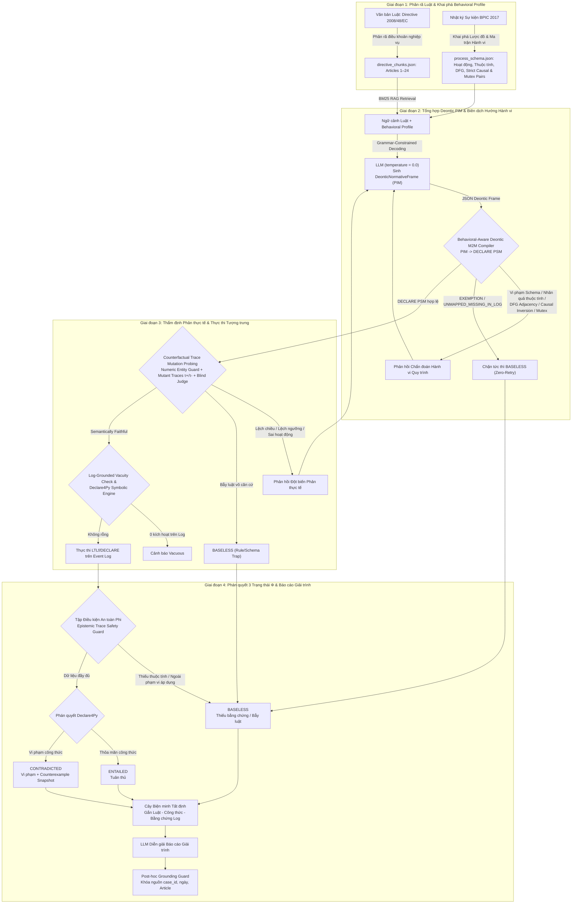

# Neuro-Symbolic + MDE for Trustworthy Reasoning in Process Mining

Dự án nghiên cứu kết hợp **Trí tuệ nhân tạo Tượng trưng - Nơ-ron (Neuro-Symbolic AI)** và **Kỹ nghệ Hướng mô hình (Model-Driven Engineering - MDE)** nhằm giải quyết vấn đề ảo giác (hallucination), thiếu khả năng giải trình và chi phí tính toán cao khi ứng dụng Mô hình ngôn ngữ lớn (LLM) vào kiểm tra tuân thủ quy trình kinh doanh (Business Process Compliance Checking).

Hệ thống được kiểm chứng thực nghiệm trên văn bản pháp lý tín dụng tiêu dùng châu Âu (**Directive 2008/48/EC**) và nhật ký sự kiện ngân hàng thực tế quy mô lớn (**BPI Challenge 2017** gồm 31.509 hồ sơ và 1,2 triệu sự kiện), đánh giá chéo trên 3 mô hình LLM mã nguồn mở (`openai/gpt-oss-120b`, `qwen/qwen3.8-27b`, `openai/gpt-oss-20b`).

---

## 1. Kiến trúc Hệ thống & Quy trình Thực thi (System Architecture)

Hệ thống hoạt động theo quy trình **4 giai đoạn hợp nhất hướng hành vi (Behavioral-Aware Deontic Neuro-Symbolic Pipeline)** — không chia tầng kiểm tra tĩnh kiểu OCL, mà biên dịch trực tiếp văn bản pháp lý qua Mô hình Chuẩn tắc Độc lập Nền tảng (**Deontic PIM**) sang công thức **DECLARE PSM** được neo vào **Ma trận Hành vi Quy trình (Process Behavioral Profile)** của Event Log:



### Điểm khác biệt cốt lõi của **Behavioral-Aware Deontic MDE Compiler** (`src/mde/deontic_mde_compiler.py`)
1. **Deontic-Temporal Modality Compilation (PIM $\rightarrow$ PSM)**: Ánh xạ tất định đầy đủ cả 4 thái độ chuẩn tắc (`OBLIGATION`, `PROHIBITION` $\rightarrow$ `Absence` / `Not Response` / `Not Precedence`, `PERMISSION_RIGHT` $\rightarrow$ tiền điều kiện không bắt buộc `Precedence` / `Chain Precedence`, `EXEMPTION_OUT_OF_SCOPE` $\rightarrow$ chặn tức thì).
2. **Direct DFG Adjacency Check**: Ràng buộc liền kề (`Chain Precedence` / `Chain Response`) phải tồn tại cạnh trực tiếp (`direct_dfg_count > 0`) trong DFG của Event Log.
3. **Strict Causal Direction Invariant Check**: Chặn đảo chiều nhân quả (**Causal Direction Inversion**) và lệnh cấm rỗng do đảo chiều (**Vacuous Reversed Prohibition**, ví dụ `Not Precedence(A, B)` khi `B` luôn xảy ra trước `A` với `order_ratio >= 0.99`).
4. **Behavioral Mutual-Exclusion & Lifecycle Co-Occurrence Check**: Chặn ràng buộc đồng xuất hiện dương trên các cặp nhánh loại trừ (`co_occurrence_rate <= 0.01`) và chặn `Not Co-Existence` trên các cặp bất biến vòng đời (`>= 99%` đồng xuất hiện hai chiều).
5. **Causal Attribute Availability Check** (`src/mde/typing_environment.py` — `ProcessSchemaValidator`): Kiểm tra tính hợp lệ thực thể, kiểu toán tử và tính khả dụng nhân quả của thuộc tính sự kiện theo thứ tự phát sinh trong Behavioral Profile.

---

## 2. Kết quả Thực nghiệm Sạch & Khách quan (Clean Benchmark Results)

Toàn bộ thực nghiệm sử dụng **Bộ 30 Quy tắc Chuẩn `R01–R30`** (`DEV`: 15 quy tắc / 150 mẫu; `HELDOUT_TEST`: 15 quy tắc / 150 mẫu; 0 trùng lặp quy tắc và 0 trùng lặp mã hồ sơ) trên **300 hồ sơ phân tầng** (100 `ENTAILED`, 100 `CONTRADICTED`, 100 `BASELESS`; 224/300 = 74.7% vết nguyên bản từ BPIC 2017, loại bỏ `bfill()` để đảm bảo tính nhân quả, không từ khóa khớp luật trong `process_schema.json`, `CRASH` phạt trực tiếp vào Precision/F1, `temperature = 0.0`).

### 2.1. Kết quả Chính trên `openai/gpt-oss-120b` (`results/rq1_rq2_rq3_paper_tables.md`)

#### Bảng 1 (RQ1): Kiểm chứng Ngữ nghĩa Ràng buộc theo Độ phức tạp (`R01–R22`)

| Độ phức tạp Ràng buộc (Complexity Tier) | Đúng Ngữ nghĩa - Eq. (%) ↑ | Quá Chặt (%) ↓ | Quá Lỏng (%) ↓ | Đảo Chiều (%) ↓ | Sai Hoạt động (%) ↓ | Từ chối / Lỗi khác (%) ↓ |
| :--- | :---: | :---: | :---: | :---: | :---: | :---: |
| **1A. Round-1 Behavioral Deontic Synthesis (Tắt Counterfactual Probe & tự sửa)** | | | | | | |
| • Tier 1: Control-Flow Only | **58.33%** | 0.0% | 8.33% | 0.0% | 33.33% | 0.0% |
| • Tier 2: Temporal & Data-Aware | **100.0%** | 0.0% | 0.0% | 0.0% | 0.0% | 0.0% |
| • **Overall Pipeline (One-Shot MDE)** | **77.27%** | 0.0% | 4.55% | 0.0% | 18.18% | 0.0% |
| **1B. Full Pipeline (Bật Behavioral Deontic Compiler + Counterfactual Probe + Tự sửa)** | | | | | | |
| • Tier 1: Control-Flow Only | **66.67%** | 0.0% | 8.33% | 0.0% | 25.0% | 0.0% |
| • Tier 2: Temporal & Data-Aware | **90.0%** | 0.0% | 0.0% | 0.0% | 0.0% | 10.0% |
| • **Overall Pipeline (Full)** | **77.27%** | 0.0% | 4.55% | 0.0% | 13.64% | 4.55% |

> *Ghi chú Bảng 1*: Cả 1A và 1B đều có `Reversed = 0.0%`, `Crash = 0.0%` và `Vacuous = 0.0%` (`Abstained = 4.55%` ở 1B).

#### Bảng 2 (RQ2): Nghiên cứu Triệt tiêu (Ablation Study) & So sánh Baseline (300 mẫu)

| Cấu hình Thực nghiệm (Configuration) | Thực thi Hợp lệ (%) ↑ | Norm Eq (`R01–R22` %) ↑ | Trap Detect (`R23–R30` %) ↑ | Accuracy (%) ↑ | Macro-F1 ↑ |
| :--- | :---: | :---: | :---: | :---: | :---: |
| **Baseline 1: Vanilla RAG + LLM Direct QA** | *N/A* | *N/A* | 57.0% | 55.67% | **0.5532** |
| **Baseline 2: One-Shot LLM-to-DECLARE** *(Không qua Compiler & Counterfactual)* | 90.67% | 67.0% | 63.0% | 67.67% | **0.6772** |
| **- Self-Correction Loop** *(Tắt Vòng lặp Tự sửa)* | 100.0% | 71.0% | 87.0% | 85.0% | **0.85** |
| **- Behavioral Deontic Compiler** *(Tắt Biên dịch Deontic & Behavioral Profile)* | 90.67% | 54.0% | 76.0% | 76.0% | **0.7586** |
| **Full Neuro-Symbolic Pipeline (Đề xuất)** | **100.0%** | **76.0%** | **87.0%** | **88.33%** | **0.8836** |

> *Chi tiết Bảng 2*:
> - **Phân tách `DEV` vs `HELDOUT_TEST` (Full Pipeline, 150 mẫu/tập)**: `DEV` đạt `Accuracy = 92.67%`, `Macro-F1 = 0.9258` (`Trap = 100.0%`); `HELDOUT_TEST` đạt `Accuracy = 84.0%`, `Macro-F1 = 0.8391` (`Trap = 74.0%`).
> - **Phát hiện bẫy `R23–R30` (Full Pipeline)**: `Rule/Schema Trap = 82.89%` (`5/6` loại bẫy luật/lược đồ: `R23, R24, R25, R27, R28`), `Trace Φ = 100.0%` (`2/2` loại bẫy log: `R29, R30`); tổng hợp `Trap Detect = 87.0%`.
> - **Tỷ lệ `Crash`**: Baseline 2 và `- Behavioral Deontic Compiler` có `Crash = 9.33%`; Full Pipeline và `- Self-Correction` có `Crash = 0.0%`.

#### Bảng 3 (RQ3): Hiệu năng Chẩn đoán 3 Trạng thái & Giải trình (300 mẫu, bật `--with-explanations`)

| Nhãn Phân loại Tuân thủ (Compliance Verdict) | Precision ↑ | Recall ↑ | F1-Score ↑ | Số vòng sửa TB | Thời gian TB (s) ↓ | Citation Fidelity (%) ↑ |
| :--- | :---: | :---: | :---: | :---: | :---: | :---: |
| **ENTAILED (Tuân thủ)** | 0.8067 | 0.96 | **0.8767** | 0.05 | 0.0067s | **76.0%** |
| **CONTRADICTED (Vi phạm)** | 0.9535 | 0.82 | **0.8817** | 0.05 | 0.0046s | **76.0%** |
| **BASELESS (Ảo giác / Thiếu Φ)** | 0.9158 | 0.87 | **0.8923** | 0.0 | 0.0013s | **87.0%** |
| **Trung bình Toàn hệ thống (Overall)** | **0.892** | **0.8833** | **0.8836** | **0.03** | **0.0042s** | **79.67%** |

---

### 2.2. Khái quát hóa Đa mô hình (Cross-Model Generalization, 300 mẫu)

| Model | Baseline 2 Macro-F1 | `- Deontic Compiler` Macro-F1 | `- SelfCorr` Macro-F1 | Full Exec (%) ↑ | Full Reversed (%) ↓ | Full Trap Detect (%) ↑ | Full Trace Φ (%) ↑ | Full Accuracy (%) ↑ | Full Macro-F1 ↑ |
| :--- | :---: | :---: | :---: | :---: | :---: | :---: | :---: | :---: | :---: |
| **`openai/gpt-oss-20b`** | 0.5262 | 0.6484 | 0.6213 | **100.0%** | **0.0%** | 36.0% | **100.0%** | 70.67% | **0.6824** |
| **`qwen/qwen3.8-27b`** | 0.4878 | 0.8298 | 0.8582 | **100.0%** | **0.0%** | 75.0% | **100.0%** | 86.0% | **0.8582** |
| **`openai/gpt-oss-120b`** | 0.6772 | 0.7586 | 0.85 | **100.0%** | **0.0%** | **87.0%** | **100.0%** | **88.33%** | **0.8836** |

> *Lưu ý*: `qwen/qwen3.8-27b` và `openai/gpt-oss-20b` được chạy ở chế độ tắt Baseline 1 và tắt `--with-explanations` (`results/qwen3_8_27b_paper_tables.md`, `results/gpt_oss_20b_paper_tables.md`). Trên cả 3 mô hình ở 3 kích cỡ/kiến trúc khác nhau, **Full Pipeline** đều đạt **100.0% Thực thi Hợp lệ (`0.0% Crash`)**, **0.0% lỗi Đảo chiều (`Reversed`)**, **100.0% Trace Safety Guard ($\Phi$)** và vượt rõ rệt Baseline 2 lẫn cấu hình tắt Behavioral Deontic Compiler.

---

## 3. Cấu trúc Thư mục Dự án (Project Structure)

```text
neuron_symbolic_reasoning/
├── configs/
│   └── config.yaml                          # Tham số cấu hình đường dẫn dữ liệu & mô hình
├── datasets/                                # Dữ liệu thực nghiệm gốc
│   ├── directive_2008_48_EC.pdf             # Văn bản luật EU Consumer Credit Directive 2008/48/EC
│   └── BPI Challenge 2017.xes               # Nhật ký sự kiện ngân hàng (31,509 hồ sơ, 1.2M+ sự kiện)
├── data/
│   ├── interim/
│   │   └── bpic2017_events.parquet          # Bản đệm Parquet tăng tốc truy vấn sự kiện
│   └── processed/
│       ├── directive_chunks.json            # Phân đoạn điều khoản pháp lý Articles 1–24
│       ├── process_schema.json              # Lược đồ sự kiện, thuộc tính & Behavioral Profile (DFG/Causal/Mutex)
│       ├── benchmark_rules_30.json          # Bộ 30 quy tắc chuẩn R01–R30 (DEV / HELDOUT_TEST)
│       └── benchmark_items.json             # 300 mẫu hồ sơ phân tầng chuẩn (100/100/100)
├── src/                                     # Mã nguồn kiến trúc 4 giai đoạn
│   ├── preprocessing/                       # Giai đoạn 1: Bóc tách luật & Khai phá Behavioral Profile
│   ├── mde/                                 # Giai đoạn 2: Behavioral-Aware Deontic M2M Compiler & Schema Validator
│   ├── neural/                              # Giai đoạn 2: BM25 RAG & Vòng lặp Tự sửa CEGIS
│   ├── symbolic/                            # Giai đoạn 3: Counterfactual Probing, Vacuity Check & Declare4Py
│   └── evaluation/                          # Giai đoạn 4 & RQ1–RQ3: Phán quyết Φ 3 Trạng thái & Giải trình
├── scripts/
│   ├── run_clean_evaluation_without_b1.py   # Kịch bản thực nghiệm sạch đa model (tùy chọn B1 & XAI)
│   ├── rerun_full_benchmark_300.py          # Kịch bản tái chạy 300 mẫu trên cache/model mặc định
│   ├── regenerate_benchmark.py              # Tái sinh benchmark_rules_30.json & benchmark_items.json
│   ├── verify_benchmark_health.py           # Kiểm tra liêm chính & phân tầng dữ liệu benchmark
│   ├── build_benchmark.py                   # Khởi tạo file benchmark chuẩn
│   └── inspect_case.py                      # Công cụ kiểm tra thủ công từng ca benchmark (CLI)
├── tests/                                   # Bộ Unit Tests tự động (unittest)
├── results/
│   ├── real_llm_trajectories.json           # Nhật ký tự sửa (openai/gpt-oss-120b)
│   ├── rq1_rq2_rq3_evaluation_tables.json   # Số liệu RQ1–RQ3 định dạng JSON (120B)
│   ├── rq1_rq2_rq3_paper_tables.md          # Bảng kết quả sạch đầy đủ (120B + Baseline 1 + XAI)
│   ├── qwen3_8_27b_paper_tables.md          # Bảng kết quả sạch trên qwen/qwen3.8-27b
│   └── gpt_oss_20b_paper_tables.md          # Bảng kết quả sạch trên openai/gpt-oss-20b
├── real_llm_cache.json                      # Disk Cache lưu phản hồi LLM theo SHA-256
├── vanilla_rag_real_cache.json              # Disk Cache cho Baseline 1 (Vanilla RAG)
├── requirements.txt                         # Danh sách thư viện phụ thuộc
└── README.md                                # Tài liệu tổng quan dự án
```

---

## 4. Hướng dẫn Cài đặt & Tái lập Thực nghiệm (Reproducibility)

### 4.1. Khởi tạo môi trường
Yêu cầu Python 3.11+ (khuyến nghị Python 3.12 / 3.13):

```powershell
# Tạo môi trường ảo và kích hoạt
python -m venv .venv
.\.venv\Scripts\Activate.ps1

# Cài đặt toàn bộ thư viện cần thiết
pip install -r requirements.txt
```

### 4.2. Cấu hình API Key (Groq API / OpenAI-compatible)
Tạo file `.env` tại thư mục gốc của dự án. Hệ thống hỗ trợ xoay tua nhiều API Key (Round-Robin Key Rotation) khi chạm giới hạn token:
```bash
GROQ_API_KEY=gsk_primary_key_here
GROQ_API_KEYS=gsk_primary_key,gsk_backup_key_1,gsk_backup_key_2
LLM_MODEL_NAME=openai/gpt-oss-120b
LLM_BASE_URL=https://api.groq.com/openai/v1
```

### 4.3. Chạy Bộ Kiểm thử Tự động (Unit Tests) & Kiểm tra Benchmark
```powershell
.\.venv\Scripts\python.exe -m unittest discover -s tests -p "test_*.py" -v
.\.venv\Scripts\python.exe scripts/verify_benchmark_health.py
```

### 4.4. Chạy Thực nghiệm Đánh giá Đa Mô hình
```powershell
# Chạy đầy đủ Baseline 1 + Baseline 2 + Ablation + Citation Fidelity (Step 4.3) trên 120B
.\.venv\Scripts\python.exe scripts/run_clean_evaluation_without_b1.py --model openai/gpt-oss-120b --with-baseline1 --with-explanations

# Chạy trên model khác và lưu ra file riêng theo prefix
.\.venv\Scripts\python.exe scripts/run_clean_evaluation_without_b1.py --model qwen/qwen3.8-27b --out-prefix qwen3_8_27b
.\.venv\Scripts\python.exe scripts/run_clean_evaluation_without_b1.py --model openai/gpt-oss-20b --out-prefix gpt_oss_20b

# Tái lập tức thì 100% từ Disk Cache (không gọi API)
.\.venv\Scripts\python.exe scripts/run_clean_evaluation_without_b1.py --model openai/gpt-oss-120b --with-baseline1 --with-explanations --cache-only
```
